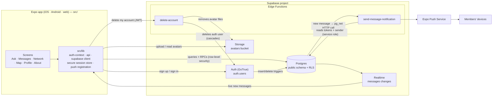
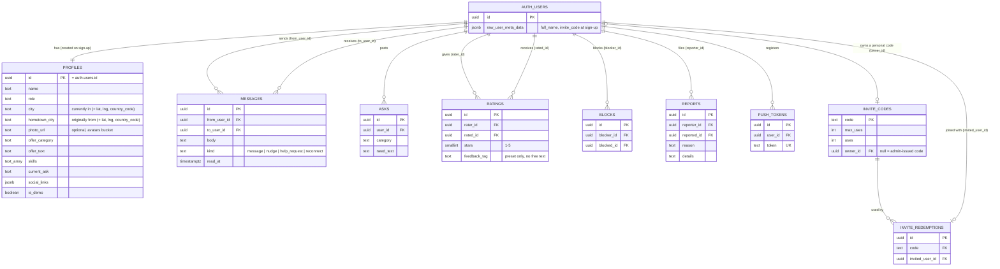
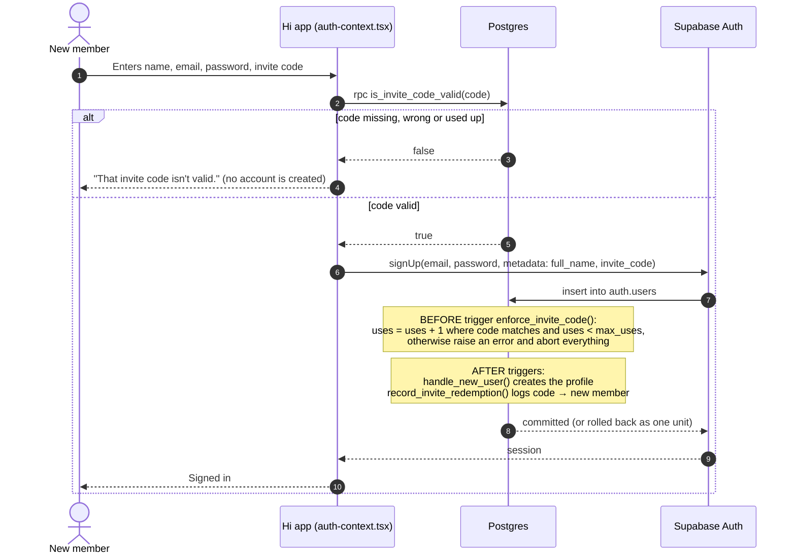

# Hi

Hi is an invite-only network app: members post what they need help with (an **ask**), find people who can help by what they offer and where they are (as a list or on a map), and message them directly. It's built with Expo (iOS, Android and web from one codebase) on top of Supabase.

## Get started

```bash
npm install
npx expo start
```

Copy `.env.example` to `.env` and fill in the Supabase URL and anon key first. Then open the app in a [development build](https://docs.expo.dev/develop/development-builds/introduction/), an emulator or simulator, [Expo Go](https://expo.dev/go), or the browser.

Database changes live in `supabase/migrations/`. Apply new ones to production with `supabase db push` (run `supabase db push --dry-run` first to see what will change).

## Architecture



- **The client talks to Supabase directly.** There's no app server; every rule about who can read or write what is enforced in Postgres with row-level security (RLS) and `security definer` functions, so it can't be bypassed by calling the API yourself.
- **Sessions** are stored with `src/lib/secure-session-store.ts` (encrypted on device).
- **Messages arrive live** through Supabase Realtime. A client only receives changes to rows its own read policy allows.
- **Push notifications:** inserting a message fires a database trigger that calls the `send-message-notification` Edge Function, which looks up the recipient's device tokens and sends through Expo's push service.
- **Account deletion** goes through the `delete-account` Edge Function, which identifies the caller from their own login token, removes their avatar files, then deletes their auth user. Everything else they own is removed by `on delete cascade`.

## Database



### Who can see and change what (row-level security)

| Table | Read | Write |
|---|---|---|
| `profiles` | Every signed-in member (the directory *is* the network) | Only your own row |
| `messages` | Only the two people in the thread | Send as yourself, and only if neither person has blocked the other; the recipient can mark as read |
| `asks` | Every signed-in member (that's how matching works) | Post your own |
| `ratings` | Only the rater and the person rated (no public leaderboard) | Rate or re-rate someone only after you've exchanged at least one message; one rating per pair, no self-rating |
| `blocks` | Only the blocker (the blocked person can't find out) | Only the blocker |
| `reports` | Only the reporter; nobody sees reports filed against them | File your own; reviewing them is done by the operator in the Supabase dashboard |
| `push_tokens` | Only your own | Only your own |
| `invite_codes`, `invite_redemptions` | Nobody directly | Nobody directly; only through the functions in the invite section below |
| Storage `avatars` | Public (so images load directly) | Only inside your own folder (`<user id>/…`) |

Two checks need to see rows the caller's own permissions hide, so they run as `security definer` functions that answer yes or no without exposing the rows: `is_blocked_between(a, b)` (used by the message-sending rule) and `has_messaged(a, b)` (used by the rating rules).

### What happens automatically (triggers)

| When | Trigger → function | What it does |
|---|---|---|
| Before a new auth user is inserted | `enforce_invite_code_before_signup` → `enforce_invite_code()` | Rejects the sign-up unless it carries a valid, unused-up invite code, and counts the use |
| After a new auth user is inserted | `on_auth_user_created` → `handle_new_user()` | Creates their `profiles` row, with their name from sign-up |
| After a new auth user is inserted | `record_invite_redemption_after_signup` → `record_invite_redemption()` | Records which code they joined with |
| After a message is inserted | `on_new_message_send_push` → `notify_new_message()` | Calls the push notification Edge Function |
| Before a profile or rating is updated | `profiles_set_updated_at`, `ratings_set_updated_at` | Stamps `updated_at` |

## Invite codes

Hi is invite-only: **every sign-up needs a code**, enforced inside the database so it can't be skipped by calling the sign-up API directly.

### Signing up with a code



- **Why check twice?** Supabase Auth hides any error raised inside a trigger behind a generic "Database error saving new user". The app calls `is_invite_code_valid` first only to show a clear message. The trigger is the real enforcement: it also catches a code that gets used up in the moment between the check and the sign-up.
- **All or nothing:** the code check, the use count, the new profile and the redemption record happen in one transaction. If any part fails, no account is created and no use is counted.
- Codes are matched after trimming spaces and are case-sensitive.

### Two kinds of codes

| | Admin-issued codes | Personal member codes |
|---|---|---|
| Created by | You, with SQL in the Supabase dashboard | Any member, on demand, via `get_or_create_my_invite_code()` |
| `owner_id` | `null` | The member's user id |
| Uses | Whatever you set in `max_uses` (e.g. 1 for one person, 5 for a small group) | Effectively unlimited (`max_uses` = 1,000,000) |
| How many | As many as you insert | Exactly one per member, enforced by a unique index even under simultaneous requests |
| Format | Anything you choose | 8 characters from `ABCDEFGHJKLMNPQRSTUVWXYZ23456789` (no 0/O or 1/I to avoid misreading) |

Create an admin code:

```sql
insert into public.invite_codes (code, max_uses) values ('YOUR-CODE', 1);
```

The first batch (six single-use codes and one five-use code) was created by the migration `20261002224650_seed_initial_invite_codes.sql`.

### Functions the app can call

| Function | Who can call it | Returns |
|---|---|---|
| `is_invite_code_valid(code_to_check)` | Anyone, signed in or not | `true` if the code exists and still has uses left |
| `get_or_create_my_invite_code()` | Signed-in members | The caller's personal code, creating it the first time; retries if a random code collides (up to 10 times) |
| `my_invite_stats()` | Signed-in members | The caller's code and how many people have joined with it (`invited_count`) |

### Good to know

- **Status:** the database side of personal codes is live. The app doesn't show members their code yet; that screen (with a copy button using `expo-clipboard`) is the next step.
- **Deleting accounts:** when a member deletes their account, their personal code and its redemption history are deleted with it. When someone who joined with a code deletes their account, their redemption row is removed, so `invited_count` goes down.
- **Counting:** `uses` on `invite_codes` counts every sign-up with that code; `invite_redemptions` records who each one was. Both apply to admin and personal codes.
- **Seeing who invited whom:** there's no in-app view of this; query `invite_redemptions` joined with `invite_codes.owner_id` in the dashboard.

## Project layout

```
src/
  app/                 Screens (Expo Router, file-based routes)
    (tabs)/            Ask (index), Messages, Network (explore), Map, Profile
    thread/[id].tsx    A message thread
    sign-in.tsx        Sign in / sign up with an invite code
    about.tsx, privacy-policy.tsx, terms-of-service.tsx
  components/          Shared UI (person rows, map, typeaheads, thread view…)
  lib/                 Supabase client, auth, API calls, push registration, generated DB types
supabase/
  migrations/          Every database change, in order
  functions/           Edge Functions: send-message-notification, delete-account
  config.toml          Local Supabase and function settings
```
